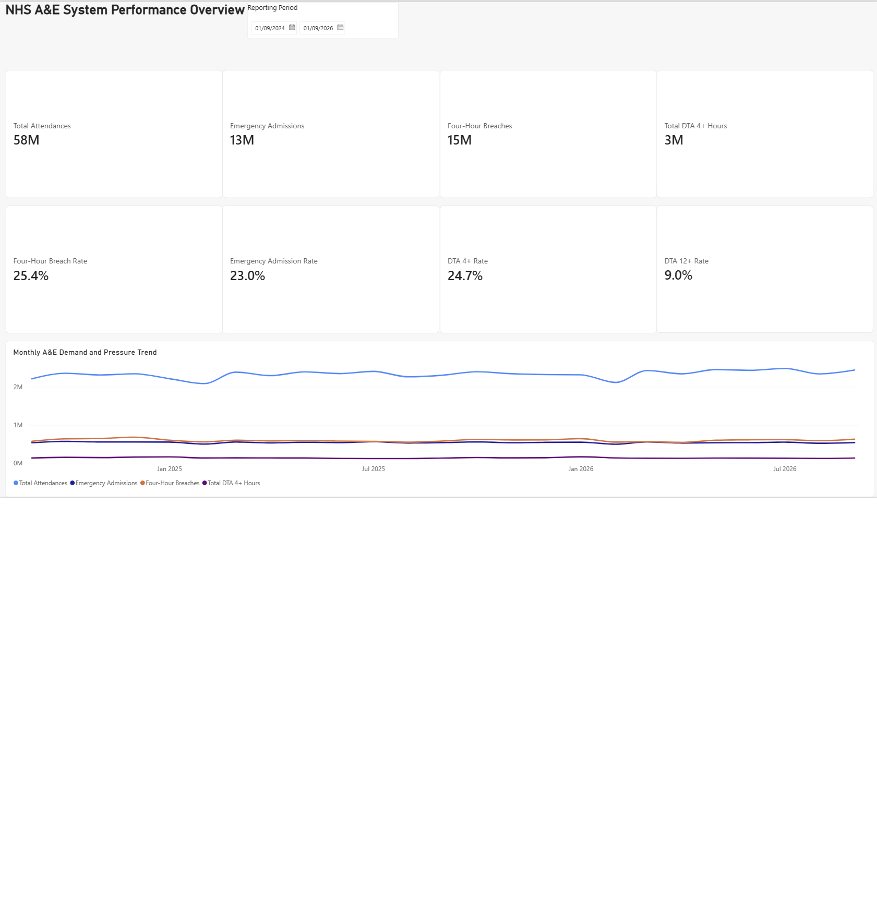
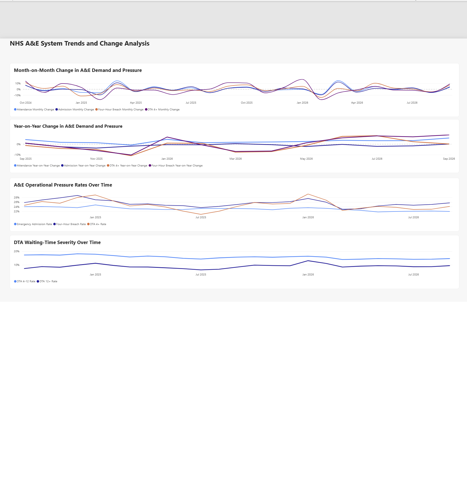
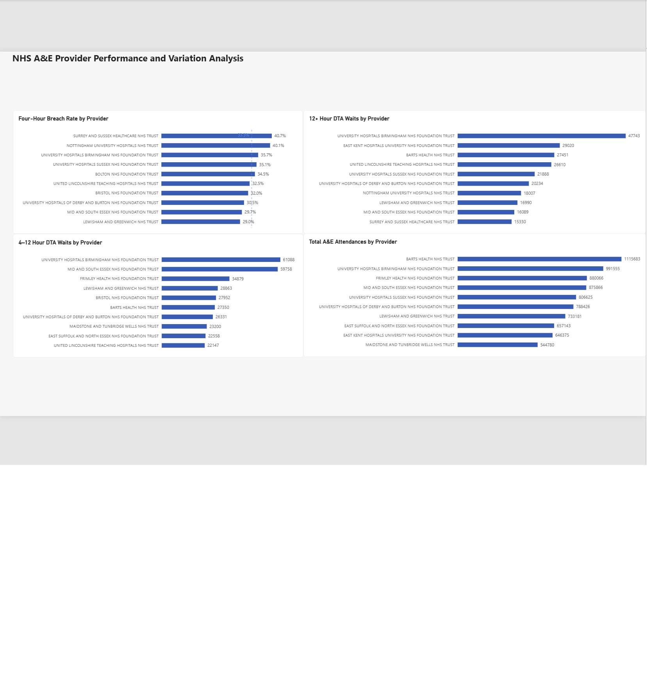
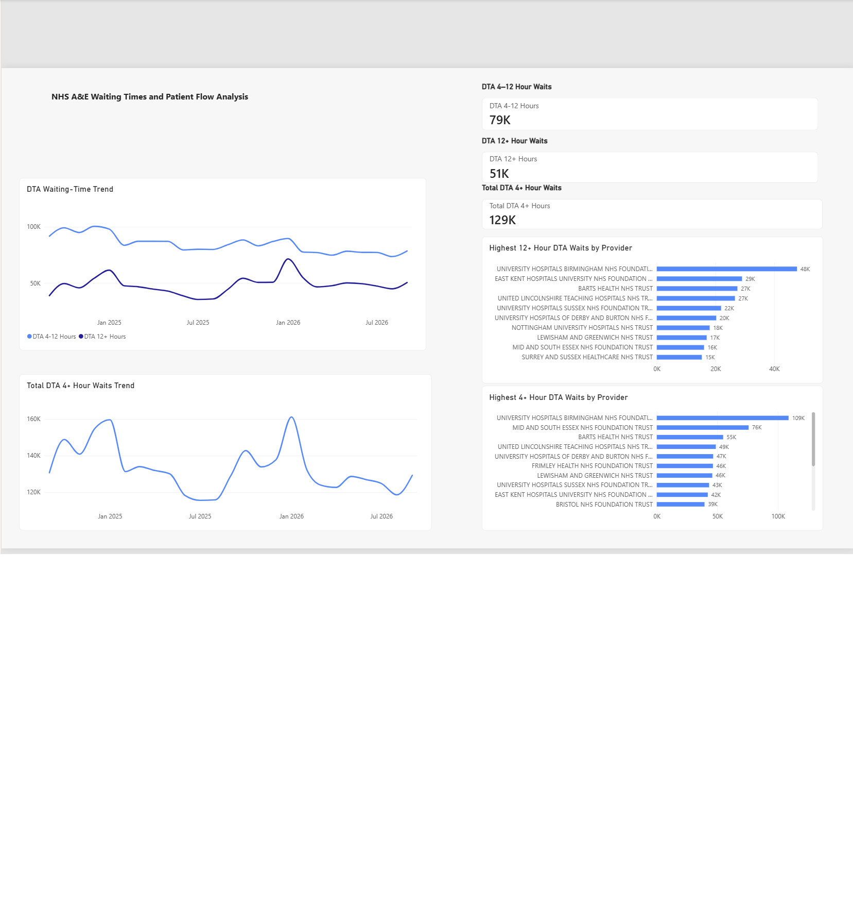

# NHS A&E Performance, Demand and Capacity Analytics

An end-to-end healthcare analytics portfolio project analysing NHS Accident & Emergency demand, performance, waiting-time pressure and provider variation using official, publicly available aggregate NHS data.

The project demonstrates a controlled analytical lifecycle from source provenance and Python data engineering through DuckDB, SQL, Jupyter investigation and Power BI decision-support reporting.

> **Portfolio focus:** reproducible healthcare analytics, data quality, longitudinal performance analysis, provider investigation and responsible interpretation of aggregate NHS data.

---

## Project Highlights

| Area | Result |
|---|---:|
| Analytical period | September 2024 – September 2026 |
| Reporting months | 25 |
| Provider-month records | 4,918 |
| Analytical columns | 23 |
| Provider codes | 207 |
| Duplicate provider-month keys | 0 |
| SQL analytical views | 5 |
| Analytical notebooks | 4 |
| Power BI dashboard pages | 4 |
| Automated tests | 138 passing |
| Type checking | 72 source files, 0 issues |

---

## Power BI Decision-Support Dashboard

The Power BI reporting layer is organised around four analytical questions:

1. What is the current system position?
2. How is performance changing over time?
3. Where does provider variation exist?
4. Where do waiting-time and patient-flow pressures require investigation?

### 1. System Performance Overview



System-level view of A&E activity, emergency admissions, four-hour breaches, decision-to-admit waits and monthly demand and pressure trends.

### 2. System Trends and Change



Longitudinal analysis using month-on-month and year-on-year change together with operational-pressure indicators.

### 3. Provider Performance and Variation



Provider-level comparison across four-hour breaches, long decision-to-admit waits and A&E activity.

Provider rankings are treated as **investigation signals**, not causal or organisational-performance conclusions.

### 4. Waiting Times and Patient Flow



Focused analysis of 4–12-hour and 12-hour-plus decision-to-admit waits, total 4+ hour waits and provider-level long-wait variation.

---

## Key Analytical Findings

### Demand increased more strongly than emergency admissions

Total A&E attendances increased from approximately **2.214 million in September 2024 to 2.445 million in September 2026**.

At the September 2026 endpoint:

- A&E attendances were approximately **5.82% higher year on year**.
- Emergency admissions were approximately **0.11% higher year on year**.

The two measures therefore showed different longitudinal patterns and should not be treated as interchangeable indicators of operational pressure.

### Four-hour breaches increased

At September 2026, four-hour breaches were approximately **8.74% higher year on year**.

### Headline DTA stability concealed a shift in waiting severity

One of the project's most important findings concerned decision-to-admit waits.

At September 2026:

- Total DTA waits of 4+ hours: approximately **+0.15% YoY**
- DTA waits of 4–12 hours: approximately **−6.67% YoY**
- DTA waits of 12+ hours: approximately **+12.99% YoY**

The overall 4+ hour total appeared broadly stable, but its composition had shifted toward the longest waits.

> **Analytical insight:** a stable aggregate KPI can conceal a material deterioration in severity.

The aggregate dataset identifies this change but does not establish its causal explanation.

---

## Provider Investigation

Provider analysis goes beyond simple ranking.

The controlled investigation framework combines:

- absolute change in four-hour breaches;
- absolute change in 12-hour-plus DTA waits;
- recent six-month slopes;
- persistence above analytical medians;
- robust-outlier indicators;
- investigation-priority scoring.

The final controlled output contains **18 prioritised provider records**.

These results are designed to answer:

> **Where should further analytical or operational investigation be prioritised?**

They are **not** used to claim that an organisation is failing or to establish causation from aggregate data.

---

## Analytical Architecture

```text
Official NHS monthly A&E source files
                │
                ▼
       Python engineering & QA
     ├── source provenance
     ├── SHA-256 integrity
     ├── transformation
     ├── validation
     └── reconciliation
                │
                ▼
   Validated 25-month provider dataset
                │
                ▼
              DuckDB
                │
                ▼
     Version-controlled SQL layer
     ├── monthly KPIs
     ├── monthly pressure
     ├── provider summary
     ├── provider change
     └── provider pressure
                │
                ▼
             Jupyter
     ├── source profiling
     ├── system trends
     ├── provider variation
     └── pressure investigation
                │
                ▼
             Power BI
       Decision-support reporting
```

### Separation of responsibilities

**Python**  
Engineering, transformation, validation, reconciliation and controlled dataset construction.

**DuckDB + SQL**  
Persistent analytical storage and reusable governed analytical datasets.

**Jupyter**  
Exploratory, longitudinal and provider-level analytical investigation.

**Power BI**  
Semantic modelling, governed reporting and decision-support communication.

**PowerShell**  
Execution and QA control only; reusable analytical logic remains in version-controlled project artefacts.

---

## Data Engineering and Quality Assurance

The project implements explicit controls for:

- source registration and provenance;
- SHA-256 source-file integrity;
- immutable raw-data retention;
- schema validation;
- required-field validation;
- provider identifier integrity;
- controlled numeric transformation;
- negative-value checks;
- provider-month business-key validation;
- exclusion of published TOTAL rows from provider-level analysis;
- reconciliation against published totals;
- complete reporting-month sequence validation;
- analytical-layer reconciliation.

Published TOTAL records are retained as reconciliation controls rather than included in provider-level analytical records, preventing double counting while preserving an authoritative validation reference.

---

## Reproducible Workflow

The project includes a reusable orchestration layer:

```text
src/nhs_ae/workflow.py
```

The controlled processing sequence is:

```text
source manifest
      ↓
monthly transformation
      ↓
published-total reconciliation
      ↓
25-month dataset combination
      ↓
validated master dataset
      ↓
DuckDB database build
      ↓
version-controlled SQL views
      ↓
database validation
```

The configured master dataset path is:

```text
data/processed/nhs_ae_provider_2024_09_to_2026_09.csv
```

and the local analytical database is:

```text
data/database/nhs_ae.duckdb
```

Both are generated/local analytical artefacts and are excluded from the public repository.

See [`docs/06_reproducibility_runbook.md`](docs/06_reproducibility_runbook.md) for the complete reproducibility workflow.

---

## SQL Analytical Layer

Version-controlled SQL provides five reusable analytical views:

```text
sql/views/
├── 001_monthly_kpis.sql
├── 002_monthly_pressure.sql
├── 003_provider_summary.sql
├── 004_provider_change.sql
└── 005_provider_pressure.sql
```

The core database schema is maintained in:

```text
sql/schema/001_core_tables.sql
```

SQL analytical outputs are reconciled against validated Python outputs to maintain consistency between analytical layers.

---

## Jupyter Analytical Workflow

The analytical notebook sequence is:

```text
notebooks/
├── 01_source_data_profile.ipynb
├── 02_system_performance_trends.ipynb
├── 03_provider_variation_and_change.ipynb
└── 04_provider_pressure_investigation.ipynb
```

The notebooks provide the exploratory and analytical investigation layer.

Reusable engineering logic remains in `src/`, and governed analytical logic remains in `sql/`.

---

## Automated Quality Gates

The final project QA checkpoint completed successfully with:

```text
Ruff
All checks passed

mypy
Success: no issues found in 72 source files

pytest
138 passed
```

The automated tests cover unit, database and integration behaviour, including an end-to-end workflow rebuild against temporary outputs.

---

## Repository Structure

```text
nhs-ae-performance-analytics/
├── assets/
│   └── powerbi/
│       ├── 01_system_performance_overview.png
│       ├── 02_system_trends_change.png
│       ├── 03_provider_performance_variation.png
│       └── 04_waits_patient_flow.png
│
├── config/
│   ├── source_acquisition_2024_09_to_2026_09.json
│   ├── source_manifest_2024_09_to_2026_09.json
│   └── sources.json
│
├── data/
│   ├── raw/
│   ├── interim/
│   ├── processed/
│   ├── analytical/
│   ├── database/
│   └── reference/
│
├── docs/
│   ├── 01_project_charter.md
│   ├── 02_business_requirements.md
│   ├── 03_stakeholder_requirements.md
│   ├── 04_analytical_questions_and_kpis.md
│   ├── 05_source_data_dictionary.md
│   ├── 06_reproducibility_runbook.md
│   ├── 07_portfolio_case_study.md
│   ├── decision_log.md
│   └── nhs_ae_domain_guide.md
│
├── notebooks/
│   ├── 01_source_data_profile.ipynb
│   ├── 02_system_performance_trends.ipynb
│   ├── 03_provider_variation_and_change.ipynb
│   └── 04_provider_pressure_investigation.ipynb
│
├── powerbi/
├── reports/
│
├── sql/
│   ├── schema/
│   │   └── 001_core_tables.sql
│   └── views/
│       ├── 001_monthly_kpis.sql
│       ├── 002_monthly_pressure.sql
│       ├── 003_provider_summary.sql
│       ├── 004_provider_change.sql
│       └── 005_provider_pressure.sql
│
├── src/
│   └── nhs_ae/
│       ├── analysis/
│       ├── database/
│       ├── domain/
│       ├── ingestion/
│       ├── transformation/
│       ├── validation/
│       ├── config.py
│       └── workflow.py
│
├── tests/
│   ├── database/
│   ├── integration/
│   └── unit/
│
├── .gitignore
├── pyproject.toml
└── README.md
```

---

## Local Development Setup

### Requirements

- Python 3.12+
- Git
- Windows PowerShell or equivalent shell

### Create the environment

```powershell
py -3.12 -m venv .venv
.\.venv\Scripts\Activate.ps1

python -m pip install --upgrade pip
pip install -e ".[dev,analysis]"
```

### Run quality checks

```powershell
ruff check .
python -m mypy
pytest
```

---

## Rebuilding the Analytical Stack

The reusable Python workflow is:

```python
from nhs_ae.workflow import run_workflow

run_workflow()
```

The default workflow expects the controlled monthly source files referenced by the source manifest to exist locally.

Raw, interim, processed, analytical and database outputs are intentionally excluded from Git.

---

## Data and Repository Policy

This repository is designed to publish the **analytical implementation**, not generated data products.

The public repository contains:

- version-controlled Python source code;
- SQL schema and analytical views;
- analytical notebooks;
- source-control metadata/configuration;
- tests;
- governance and analytical documentation;
- Power BI portfolio screenshots.

The following remain local and are excluded by `.gitignore`:

- raw source datasets;
- interim transformed datasets;
- processed analytical datasets;
- generated analytical CSV outputs;
- DuckDB databases;
- `.pbix` files;
- virtual environments;
- caches and temporary outputs.

Only official, publicly available, aggregate data is used by the project.

No patient-identifiable, confidential or restricted health data is required.

---

## Analytical Governance and Limitations

This project uses aggregate monthly NHS data.

Therefore:

- results cannot explain individual patient outcomes;
- provider rankings do not establish causation;
- provider comparisons require operational context;
- organisational changes may affect longitudinal comparability;
- investigation-priority scores are signals, not performance judgements;
- KPI definitions must remain consistent across analytical platforms.

The project prioritises **reproducibility, transparency and defensible interpretation** over unsupported causal claims.

---

## Technology

### Data engineering and analysis

- Python 3.12+
- pandas
- PyArrow
- Pydantic
- DuckDB
- SQL

### Investigation

- JupyterLab
- Matplotlib
- Seaborn
- Statsmodels

### Reporting

- Power BI
- DAX

### Quality

- Pytest
- Ruff
- mypylling
- provider variation analysis
- investigation prioritisation
- Power BI semantic modelling
- dashboard design
- analytical governance
- automated testing
- reproducible workflow design
- technical documentation
- responsible interpretation of aggregate healthcare data

---

## Project Documentation

For deeper technical and analytical detail:

- docs/01_project_charter.md
- docs/02_business_requirements.md
- docs/03_stakeholder_requirements.md
- docs/04_analytical_questions_and_kpis.md
- docs/05_source_data_dictionary.md
- docs/06_reproducibility_runbook.md
- docs/07_portfolio_case_study.md
- docs/decision_log.md
- docs/nhs_ae_domain_guide.md

---

## Portfolio Purpose

This project was developed as a professional healthcare analytics portfolio case study demonstrating capability across the full analytical lifecycle:

> **Business question → controlled data → quality assurance → reusable analytics → investigation → decision support → governance**

The emphasis is not simply on producing visualisations, but on building analytical outputs that are **traceable, reproducible and appropriately interpreted**.
